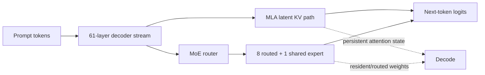
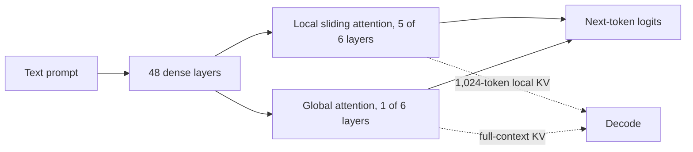

# Later verified additions

Verified 2026-11-25. These are additional controls and comparison points; they
do not replace the four starting case studies or alter their controlled
baseline.

## Kimi K2 — MoE plus MLA control

Primary evidence: [Moonshot's Kimi-K2-Instruct model card at revision `fd1984e`](https://huggingface.co/moonshotai/Kimi-K2-Instruct/tree/fd1984e2b7a3350dbf7305fe73a4ede25c14de50).

The card reports a 1T-parameter, 32B-activated MoE with 61 layers, one dense
layer, 64 attention heads, MLA, 384 experts, 8 selected experts plus 1 shared
expert, 160K vocabulary, and 128K context. It also lists vLLM, SGLang,
KTransformers, and TensorRT-LLM as recommended deployment engines and says the
released checkpoint is block-FP8.

Stored: latent attention state, resident expert weights, and the current
hidden stream. Read: MLA state and routed expert weights. Updated: hidden
states and attention state. Routed: token-to-expert dispatch. Unknown: exact
runtime page layout, all-to-all traffic, expert skew, and measured latency
under the listed engines. The 32B activated number is not a VRAM or total
resident-weight estimate.

## Gemma 3 12B — dense text-only control

Primary implementation evidence: [Google DeepMind's open Gemma architecture
code at `19e2a139`](https://github.com/google-deepmind/gemma/blob/19e2a13999ba10b818ee128dfe33a8d50afa1684/gemma/gm/nn/_gemma.py),
with a compatibility/config reference in [Google's Gemma PyTorch
configuration at `014acb7`](https://github.com/google/gemma_pytorch/blob/014acb7ac4563a5f77c76d7ff98f31b568c16508/gemma/config.py).

The official configuration defines a dense 48-layer Gemma 3 12B text backbone
with hidden size 3,840, 16 query heads, 8 KV heads, head dimension 256, and a
repeating five-local/one-global attention pattern. The local window is 1,024
tokens; the published maximum-position setting is 131,072 and the vocabulary
is 262,144. Gemma 3 is a multimodal family, but the official implementation
supports a text-only path that omits the vision encoder; this is the control
used here. No weight or runtime was downloaded.

Stored: local and global attention KV plus dense weights. Read: a bounded
window in local layers and full history in global layers. Updated: each layer's
hidden stream and KV. Routed: none. Reused: weights across tokens, not across
layer applications. This is a dense/local-global control, not evidence that
Gemma's quality or latency is comparable to the frontier families.

## Comparison role

| Addition | Isolates | Does not establish |
|---|---|---|
| Kimi K2 | MLA KV representation plus large sparse expert routing | That MLA, MoE activation, or block-FP8 produces a measured serving win |
| Gemma 3 12B | Dense weights with GQA and periodic local/global attention | That local/global attention reproduces any frontier model's quality |

Both additions remain at the published-design/config-evidence levels. Exact
model runs are `UNRUN` because Torch/Transformers and approved local weights
are unavailable in this workspace.
