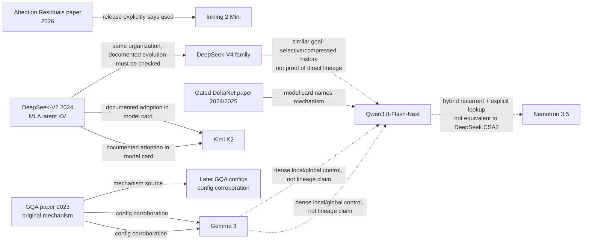

# Frontier architecture lineage — evidence-labeled

Date: 2026-11-25. An arrow is only a documented lineage claim when the source
explicitly attributes the mechanism. Shared names or similar diagrams are
marked as similarity/inference, not ancestry.

## Documented connections

- GQA is the original source for grouped KV heads; a later model using GQA is
  an adoption/config fact only when its config or report confirms the head
  layout.
- DeepSeek-V2 documents MLA. DeepSeek-V4.1-Flash documents CSA2 and cross-layer
  reuse. The study treats these as a historical mechanism path, not as a claim
  that CSA2 is MLA.
- Gated DeltaNet's original paper describes the gated delta rule and hybrid
  architectures. Qwen3.8-Flash-Next's model card explicitly names Gated
  DeltaNet in its 48-layer layout.
- Attention Residuals is the original paper. Inkling's release article
  explicitly states that its looped design uses attention residuals.

## Similarity or inference only

- Selective memory appears in DeepSeek CSA2, Qwen QSA, and Nemotron hybrid
  state, but similar workload motivation does not establish influence.
- “Active parameters” is a reporting convention shared by MoE releases; it is
  not a common definition of resident memory, routing traffic, or latency.
- A model with recurrent state can still include explicit lookup layers; fixed
  state and token-addressable history are different state paths.
- Kimi K2's MLA and Gemma 3's GQA/local-global schedule are comparison
  controls, not evidence of direct influence on the four starting families.
- Kimi K2's MLA and Gemma 3's GQA/local-global schedule are comparison
  controls, not evidence of direct influence on the four starting families.
