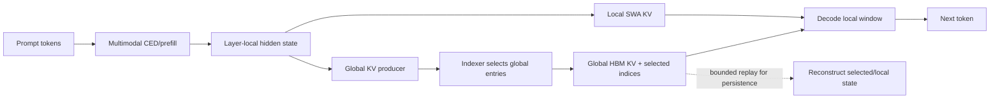
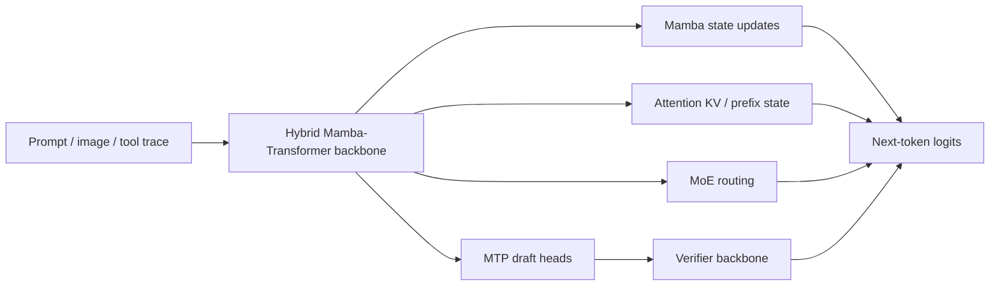
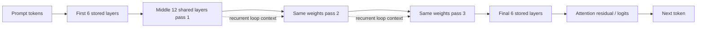

# Frontier architecture model cards

Initial comparable cards, verified 2026-11-25. These cards describe public
design evidence; they are not independent throughput or quality benchmarks.

## Comparison at a glance

| Family | Modality | Stored depth | Per-token state path | Routing/active convention | Public context | Evidence |
|---|---|---:|---|---|---:|---|
| DeepSeek-V4.1-Flash | Multimodal | 40 CED layers: 20 causal-encoder + 20 decoder; pinned config has 40 text layers, hidden 5,120, 64 Q / 1 KV, head dim 512 | CSA2 static Full/Reindex/Reuse modes share main KV/indexer K and can reuse Top-K indices; released inference code shows 128-token ring KV, separate KV/index source ownership, causal visibility masks, top-k 512, candidate blocks, FP4 compressed KV and FP8 window KV; three MTP layers | 552B backbone; 8B prefill / 16B decode active claim | 1M configured positions | Report + pinned card/config/inference code |
| Qwen3.8-Flash-Next | Vision + text | 48; pinned config repeats 3 `linear_attention` blocks then 1 `full_attention` block; linear state 16 K / 48 V heads; full attention 24 Q / 2 KV | Qwen card names Gated DeltaNet + QSA; config gives index budget 2,048 and one MTP layer | 125B total / 6B activated, plus 51B n-gram and 4B MTP | 262k native, up to 1M | Model card/config revision `812d96e`; HF metadata confirms `Qwen4ExpForConditionalGeneration` |
| Nemotron 3.5 Super | Multimodal | Pinned config has 88 LLM blocks: 40 Mamba + 40 MoE + 8 attention; 32 Q / 2 KV heads | Hybrid-state caching, prefix reuse, Mamba checkpointing; 512 routed experts, 22 active/token; one MTP attention+MoE pair; 262,144 configured positions, release claims 1M extension | 120B total / 12B active | 262k base config; 1M release extension | NVIDIA release + pinned HF config/card |
| Nemotron 3.5 Lightning | Text | Pinned config has 52 blocks: 23 Mamba + 23 MoE + 6 attention; 32 Q / 2 KV heads | 128 routed experts, 6 active/token; one MTP attention+MoE pair; 262,144 configured positions | 30B total / 3B active | 262k base config; 1M after long-context phase | NVIDIA release + pinned HF config/card; do not merge with Super facts |
| Inkling 2 Mini | Vision + text | 24 stored layers; middle 12 loop 3× | Hybrid local/global attention with shared-weight middle loop and attention residuals | 26.4B total / 3.4B active; 5.4B effective active after looping | 1M | Model card + release article |

## DeepSeek-V4.1-Flash

Documented mechanism: the 40-layer CED has a 20-layer causal encoder followed by
a 20-layer decoder. CSA2 uses static Full, Reindex, and Reuse modes to share
main KV and indexer K and reuse Top-K indices, alongside FP4 KV storage. The
report/card say global HBM KV is 890 bytes/token and persistent KV can be
reduced further through SWA Bounded Replay. Those are separate accounting
boundaries: global HBM KV is not total model memory, and persistent replay is not
the same as decode latency.

Stored: global KV, selected indices, and local SWA state. Read: selected global
entries and local window. Updated: each layer's hidden state and the current
local window. Reused: cross-layer global cache and, in the reported deployment
path, bounded-replay reconstruction. Unknown: exact layer schedule and the
runtime's physical page/layout representation.

## Qwen3.8-Flash-Next

The model card gives a 12× repeated four-block layout. DeltaNet maintains a
fixed recurrent matrix state in its blocks; QSA is the explicit history lookup
path. QSA's 512-block/2048-token budget is a selected-read budget, not the
context window. Experts are a separate weight-routing path.

```mermaid
flowchart LR
  P[Prompt tokens] --> H[Hidden stream]
  H --> D[3x Gated DeltaNet]
  D --> S[Recurrent matrix state updated]
  S --> M[MoE route: 10 routed + 1 shared]
  M --> Q[QSA block]
  Q --> X[Indexer selects up to 512 blocks / 2048 tokens]
  X --> K[Explicit selected history read]
  K --> M2[MoE route]
  M2 --> G[Gated residual]
  G --> T[MTP head / next-token logits]
```

Stored: DeltaNet state, selected QSA history, expert weights, n-gram tables,
and MTP parameters. Read: recurrent state and selected older entries. Updated:
recurrent state and residual stream. Routed: token-to-expert dispatch. Reused:
resident expert weights and n-gram tables. Unknown: engine-specific paging,
all-to-all traffic, and exact post-training runtime scheduling.

## Nemotron 3.5 Super and Lightning

The public release page establishes family-level behavior but does not, by
itself, establish an exact layer schedule or state tensor shapes. Super is
multimodal; Lightning is text-only and must remain a separate card in any
runtime comparison.

Stored: recurrent Mamba state, attention/prefix state, resident experts, and
draft/verifier state. Read: hybrid state and selected expert weights. Updated:
Mamba state and attention state. Routed: expert dispatch and draft positions.
Reused: prefix state where the engine supports it. The pinned configs resolve
the previously unknown block schedules: Super has 40 Mamba, 40 MoE, and 8
attention blocks; Lightning has 23 Mamba, 23 MoE, and 6 attention blocks.
Still unknown: exact state tensor layout, draft acceptance distribution, and
platform-dependent kernel behavior.

## Inkling 2 Mini

The model card and release article agree on 24 stored layers, with the middle
12 applied three times. This raises layer applications per token from 24 to 48
without doubling stored layer weights. It is not equivalent to emitting extra
visible reasoning tokens.

Stored: 24 layers, expert weights, and attention state. Read: middle-layer
weights three times and loop/residual state. Updated: hidden stream and KV
state according to the runtime's hybrid attention schedule. Reused: middle
layer weights. Unknown: exact KV layout and runtime paging for loop passes.

## Workload decision matrix — current hypothesis

This is a test plan, not a ranking.

| Workload | State pressure | Most relevant mechanism | What would falsify the hypothesis | Current evidence |
|---|---|---|---|---|
| Coding agent, short turns | Decode latency, tool traces, draft acceptance | MTP/speculation; looped depth; resident expert traffic | Draft verification overhead dominates or looped model loses instruction adherence | Published design only |
| Interactive multi-turn request | Prefix reuse and state handoff | Prefix/KV reuse; recurrent state; cache ownership | State serialization or stale selection erases reuse benefit | Executable toy proxy for accounting only |
| Long-document QA | HBM/host state and distractor recall | Selective lookup, SWA, recurrent-plus-lookup hybrid | Exact late recall falls as distractors increase | Model reports; no independent run |
| High-concurrency serving | Resident weights, KV bytes, routing skew | GQA/MLA-like KV reduction, MoE routing, quantization | All-to-all, page fragmentation, or unsupported kernels dominate | No local engine measurement |

## Later verified controls

| Family/control | Stored depth and attention | State/data path | Routing and context | Evidence status |
|---|---|---|---|---|
| Kimi K2 | 61 layers; MLA; one dense layer | Latent MLA attention state plus hidden stream | 1T total / 32B activated; 384 experts, 8 routed + 1 shared; 128K | Published card/config evidence; exact run `UNRUN` |
| Gemma 3 12B text-only | 48 dense layers; 16 Q / 8 KV; five local layers then one global; 1,024 local window | Local-window KV plus periodic full-context KV | No MoE; 131,072-position configuration | Official code/config evidence; exact run `UNRUN` |

These controls sharpen interpretation: Kimi separates MLA compression from
expert routing, while Gemma supplies a dense GQA/local-global reference. They
are not a new leaderboard or a claim of equal quality.

## Later verified controls

| Family/control | Stored depth and attention | State/data path | Routing and context | Evidence status |
|---|---|---|---|---|
| Kimi K2 | 61 layers; MLA; one dense layer | Latent MLA attention state plus hidden stream | 1T total / 32B activated; 384 experts, 8 routed + 1 shared; 128K | Published card/config evidence; exact run `UNRUN` |
| Gemma 3 12B text-only | 48 dense layers; 16 Q / 8 KV; five local layers then one global; 1,024 local window | Local-window KV plus periodic full-context KV | No MoE; 131,072-position configuration | Official code/config evidence; exact run `UNRUN` |

These controls sharpen interpretation: Kimi separates MLA compression from
expert routing, while Gemma supplies a dense GQA/local-global reference. They
are not a new leaderboard or a claim of equal quality.

## Open verification items

- Pin and inspect exact model-card/config revisions for all four releases.
- Add a lineage diagram that distinguishes documented attribution from analyst
  similarity or inference.
- Verify one permitted small checkpoint/runtime only if already available
  locally; no frontier-weight download is assumed.
- Extend the toy proxy with distractor-aware selection disagreement and exact
  short-sequence parity tests.
