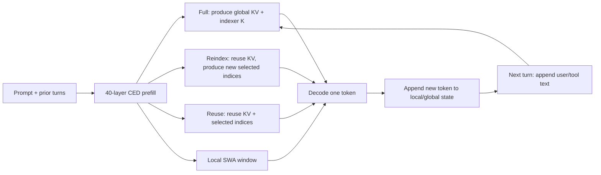
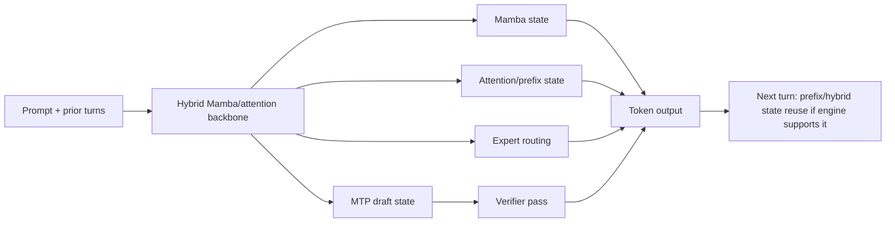
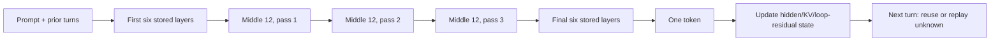

# Frontier state trace: prompt, one token, and the next turn

Verified 2026-11-25. This is a design-evidence ledger, not a claim about
undisclosed engine internals. “Stored” means the published architecture says a
state exists; “serialized” means an engine handoff was actually observed. No
frontier engine run was available in this workspace, so serialization is
`UNKNOWN` for every frontier family below.

## Common event sequence

```mermaid
sequenceDiagram
  participant U as User turn
  participant P as Prefill
  participant S as Persistent state
  participant D as Decode
  participant T as Tool/user next turn
  U->>P: tokenize prompt + prior conversation
  P->>S: create/update KV, recurrent, index, or loop state
  P->>D: final hidden state + generation state
  D->>D: read/update state for one generated token
  D-->>U: token t
  U->>T: append assistant output, tool result, or new user text
  T->>P: reuse prefix/state if engine supports it; otherwise replay
  P->>S: extend, invalidate, or rebuild state
```

The dataflow has three distinct costs:

1. **Prompt processing:** create state and perform all indexing/routing needed
   to establish the first decode position.
2. **One-token generation:** read the state relevant to the current query and
   update it with the new token. A smaller stored state does not imply fewer
   reads, fewer expert dispatches, or fewer layer applications.
3. **Next turn:** carry a prefix/state handle, append only the new turn, or
   replay the conversation. The choice is a serving-runtime property unless a
   source explicitly specifies it.

## State ledger by family

| Family | Prompt processing creates | One generated token reads/updates | Next-turn handoff | Evidence/status |
|---|---|---|---|---|
| DeepSeek-V4.1-Flash | CED hidden stream; shared global compressed-KV/index-key state; a 128-token ring-window cache; static Full/Reindex/Reuse state; config exposes index top-k 512 and candidate top-k blocks 2,048 | Global selected entries plus the local ring window; KV-source layers write compressed state, other layers read it; index-source layers publish selections; three MTP layers are a separate draft path | Pinned inference code shows the ring/shared-cache ownership and causal visibility masks; reported bounded replay can reconstruct persistent selected/local state, but exact production serialization/invalidation remains unknown | Pinned report/card/config/inference code; exact run `UNRUN` |
| Qwen3.8-Flash-Next | 48-layer config with 3 `linear_attention` layers then 1 `full_attention`; pinned code maps the former to Gated DeltaNet with recurrent state `[batch, value_heads, key_dim, value_dim]`; QSA/index state; MoE dispatch; n-gram/MTP support state | Linear-state update with causal masking; selected full-attention history from compressed key blocks; expert routing; one MTP layer | Recurrent state is represented in the Transformers cache, but cross-turn engine serialization is not measured; explicit QSA history and n-gram state need a compatible cache format | Pinned model card/config + pinned implementation; exact run `UNRUN` |
| Nemotron 3.5 Super/Lightning | Super config: 40 Mamba + 8 attention + 40 MoE blocks; Lightning config: 23 Mamba + 6 attention + 23 MoE blocks; both include MTP state | Mamba and attention state reads/updates; routed experts; draft verification if enabled | NVIDIA documents hybrid-state caching, prefix reuse, and Mamba checkpointing at release level; exact serialization and acceptance are unknown | Pinned configs/card/release; exact run `UNRUN` |
| Inkling 2 Mini | 24 stored layers plus loop/residual state and hybrid attention state | 48 layer applications/token; middle weights reused; hidden/KV/attention-residual state updated | Prefix reuse may preserve attention state, but loop-pass state layout and invalidation are unknown | Model card/release; exact run `UNRUN` |
| Kimi K2 | MLA latent attention state, hidden stream, and MoE routing state | MLA state read/update; selected expert weights and router dispatch | Card identifies deployment engines but does not establish their state handoff behavior | Pinned model card/config; exact run `UNRUN` |
| Gemma 3 12B | Dense-layer hidden stream; local KV in five layers and global KV in one layer per group | Local window reads or global-history reads; append KV for the new token | Conventional prefix KV reuse is plausible but not verified here; text-only engine serialization unknown | Pinned official code/config; exact run `UNRUN` |

## Detailed trace: the four starting families

### DeepSeek-V4.1-Flash



The useful distinction is not merely “compressed cache.” Full, Reindex, and
Reuse separate producing cache, producing selections, and reusing both. A
fresh query can change distant selections; reused selections save index work
but can become stale. Our toy distractor probe tests this mechanism boundary
only; it does not implement CSA2.

### Qwen3.8-Flash-Next

```mermaid
flowchart LR
  P[Prompt + prior turns] --> G[Repeated 4-block group]
  G --> D[3 Gated DeltaNet blocks]
  D --> RS[Update fixed recurrent matrix state]
  RS --> M[MoE route]
  M --> Q[QSA block]
  Q --> I[Select up to documented budget]
  I --> H[Read explicit older history]
  H --> M2[MoE route + gated residual]
  M2 --> O[Next-token logits]
  O --> A[Append token; update recurrent and selected-history state]
  A --> T[Next turn: carry/replay state if supported]
```



A DeltaNet state is not an addressable copy of every old token. QSA supplies a
separate explicit-read path. The 512-block/2,048-token selection budget is a
read budget, not the context window. Multi-turn reuse therefore has at least
two possible boundaries: recurrent-state carry and explicit-history/prefix
cache carry.

### Nemotron 3.5



The release describes hybrid-state caching and prefix reuse, but the exact
state boundary and MTP acceptance path require a checked runtime. Do not
compare Super's multimodal state or Lightning's text-only state as though they
were one checkpoint.

### Inkling 2 Mini



The loop changes layer applications from 24 stored layers to 48 applications
per token. Weight reuse is established by the release; KV/state serialization
across turns is not. The extra internal depth must be counted separately from
visible reasoning tokens and from stored parameter bytes.

## Multi-turn experiment contract

If an approved local checkpoint and engine become available, use the same
conversation and measure these cases separately:

| Case | Prompt action | Required measurements |
|---|---|---|
| Cold turn | Replay all prior turns | Prefill latency, state bytes, first-token latency |
| Prefix-reused turn | Reuse the unchanged conversation prefix | Reused bytes, new bytes, invalidated bytes, first-token latency |
| Tool-append turn | Append a tool result with a distant distractor | Selection disagreement, state rebuild, exact recall |
| Recurrent handoff | Carry recurrent state without replay where supported | State bytes, state-update cost, answer/recall parity |
| Long decode | Generate a fixed number of tokens | Bytes touched/token, decode tail, accepted draft positions if applicable |

Required labels are `UNRUN` until the engine exposes the relevant state. A
published “prefix caching” claim is not a measurement of state serialization,
and a toy state handoff is not proof of a production engine path.

## Current evidence boundary

- Published design/config: all rows above, with source links in the [source
  register](frontier-architecture-source-register-2026-11-25.md).
- Executable toy proxy: cache ownership, fresh/reused selection, recurrent
  state plus periodic lookup, and shared-weight depth in
  `code/src/arch_adv_2026/frontier_mechanisms.py`.
- Exact model run: `UNRUN`; no Torch/Transformers runtime or approved local
  frontier weights are present.
- Independent workload reproduction: `UNRUN`; no claim is made from vendor
  throughput or benchmark tables.
